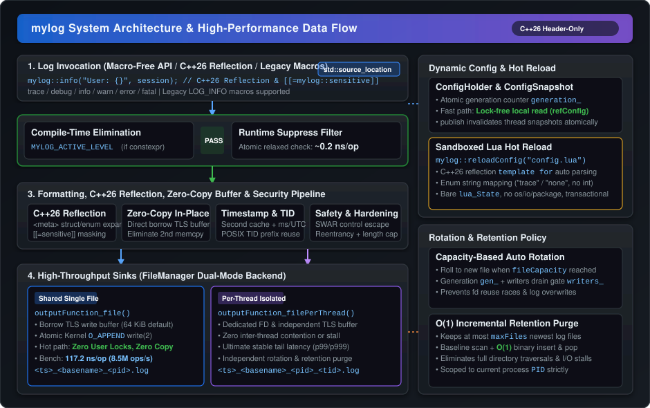

# mylog

<p align="center">
  
  
  
  
  
  
  
  
</p>

<p align="center">
  <b><a href="README.md">English</a></b> | <b><a href="README_zh.md">中文</a></b>
</p>

`mylog` is a high-performance, lightweight, header-only C++26 logging library designed for high-concurrency Linux environments.

The core library is **100% dependency-free** (requiring only standard C++26 and POSIX APIs). It deeply integrates modern C++26 `std::format` type-safe formatting with C++26 static reflection (`<meta>`), modern macro-free logging via `std::source_location`, sensitive field masking, and zero-copy direct buffer formatting, achieving both peak performance and enterprise-grade safety.

---

## Architecture & Data Flow

<p align="center">
  
</p>

### Pipeline Overview:

1. **User Log Invocation**:
   - **Modern C++26 Macro-Free API**: First-class `mylog::info(...)`, `mylog::debug(...)`, `mylog::warn(...)`, `mylog::error(...)`, `mylog::fatal(...)`, `mylog::trace(...)` functions that automatically capture call-site filename, function name, and line number using `std::source_location` without macro pollution.
   - **C++26 Static Reflection Formatting**: Native support for automatic formatting of user-defined aggregate structs and scoped enums; sensitive fields annotated with `[[= mylog::sensitive]]` are automatically masked as `"******"`.
   - **Legacy Macro Compatibility**: Traditional `LOG_INFO`, `LOG_DEBUG` macros are fully preserved for seamless compatibility.

2. **Sub-Nanosecond Suppressed Filtering**:
   - **Compile-Time Elimination**: Configure `MYLOG_ACTIVE_LEVEL` to eliminate lower-level logs at compile time via `if constexpr` with zero binary footprint.
   - **Runtime Level Filtering**: Atomic relaxed comparison incurs **~0.2 ns/op** cost (> 4.5 billion ops/sec), making inactive logs virtually free.

3. **Formatting, In-Place Buffer & Security Pipeline**:
   - **Zero-Copy In-Place Formatting**: When combined with `FileManager`, `std::format` borrows the thread-local file write buffer directly to build log messages in place, completely eliminating intermediate string copies and heap allocations.
   - **High-Precision Nanosecond Timestamp & TID Cache**: Thread-local second-precision text cache with in-place zero-stack nanosecond formatting (`YYYY-MM-DD HH:MM:SS.nnnnnnnnn`, 7.38M ops/s) eliminating frequent `localtime_r` lock and kernel overheads, paired with cached POSIX `gettid()` prefix.
   - **Robust Injection Defense & Zero-Exception Safety**: 64-bit SWAR branchless control character scanner and escaper (stopping ANSI injection and terminal spoofing), thread-local reentrancy protection, strict length limit truncation, and pure RAII exception-free transaction guards.

4. **FileManager Dual-Mode Storage Engine**:
   - **Shared Single File (`createFileOutputFunction`)**:
     Each thread accumulates logs into its private TLS buffer (`threadBufferCapacity`, default 64 KiB). Batches are appended to disk directly via Linux kernel `write(2)` with `O_APPEND`. Atomicity is guaranteed at the kernel file description level — **zero user-space locks and zero secondary memory copies** on the hot path, achieving **8.5M ops/s (117.2 ns/op)**.
   - **Per-Thread Dedicated Files (`createPerThreadFileOutputFunction`)**:
     Each thread writes exclusively to its dedicated log file with its private buffer, eliminating all cross-thread write contention and rotation stalls, delivering deterministic tail latency (p99/p999).

5. **Control, Dynamic Configuration & Retention**:
   - **Lock-Free Fast-Path Dynamic Configuration (`ConfigHolder` / `ConfigSnapshot`)**:
     Generation-counter snapshot pattern enables worker threads to read cached configurations locally (`refConfig()`) with zero locks on the fast path.
   - **Sandboxed Lua Hot Reload**:
     Executes inside a bare `lua_State` (standard libraries `os`, `io`, `package` disabled), leverages C++26 static reflection (`template for`) to auto-deserialize configuration fields, supports enum string parsing (`"trace"`, `"none"`, etc.), and applies configurations atomically (All-or-Nothing).
   - **Capacity-Based Rolling & Retention Policy**:
     Files roll automatically when reaching `fileCapacity`. The atomic generation and writer drain gate (`gen_` + `writers_`) guarantees safe rotation under high-concurrency appends. The $O(1)$ incremental retention queue avoids blocking threads on large directory scans and strictly verifies target thread suffixes and timestamp formats.

---

## Key Features

- **Header-Only & Zero Third-Party Dependencies (Core)**:
  - Drop the `src/` headers into your project and you are ready to go.
  - Zero external libraries required for core logging (`logger.hpp`, `fileManager.hpp`, `configHolder.hpp`, `reflection.hpp`).
  - Optional sandboxed Lua configuration module (`lua_config.hpp`) requires only LuaJIT.

- **Modern C++26 Macro-Free Logging & Static Reflection**:
  - **Macro-Free Modern API**: First-class `mylog::info(...)`, `mylog::debug(...)`, `mylog::warn(...)` functions that automatically capture call-site filename and line number using `std::source_location` without macro pollution (traditional `LOG_INFO(...)` macros are also preserved).
  - **C++26 Static Reflection (`<meta>`)**: Native support for automatic formatting of user-defined aggregate structs and scoped enums without writing manual formatters or `operator<<`.
  - **Sensitive Data Masking**: Annotate sensitive members with `[[= mylog::sensitive]]` (e.g. passwords, API tokens) to automatically render them as `"******"` in logs.
  - **Zero-Copy Direct Buffer In-Place Formatting**: Log messages are formatted directly into the destination thread-local file buffer, eliminating intermediate buffer copies and heap allocations.

- **Sub-Nanosecond Suppressed Filtering**:
  - **Compile-time pruning**: Configure `MYLOG_ACTIVE_LEVEL` to eliminate lower-level logs at compile time via `if constexpr`.
  - **Runtime level filtering**: Atomic relaxed comparison incurs **~0.2 ns/op** cost (> 4.5 billion ops/sec), making inactive logs virtually free.

- **Lock-Free Fast-Path Dynamic Configuration**:
  - Employs a generation-counter snapshot pattern (`ConfigHolder` / `ConfigSnapshot`).
  - Threads read cached configurations locally without acquiring any mutex on the fast path (`refConfig()`).
  - Runtime configuration changes (`setConfig` / `reloadConfig`) invalidate caches seamlessly across all threads.

- **High-Throughput File Backend (`FileManager`)**:
  - **Shared File Mode (`createFileOutputFunction`)**:
    - Each thread accumulates logs into its private TLS buffer (`threadBufferCapacity`, default 64 KiB).
    - Batches are written directly to disk via `write(2)` with `O_APPEND`.
    - Atomicity of file append is guaranteed at the OS kernel file description level — **zero user-space locks and zero secondary memory copies** on the hot path.
    - Safe file rotation without race conditions or file descriptor recycling hazards (`gen_` + `writers_`).
  - **Per-Thread Dedicated File Mode (`createPerThreadFileOutputFunction`)**:
    - Each thread writes exclusively to its own dedicated file (`<YYYYMMDD_HHMMSS_nnnnnnnnn>_<tid>.log`).
    - Eliminates all cross-thread write contention, delivering the most deterministic tail latency (p99/p999).

- **Automated Log Rotation & Incremental Retention**:
  - Automatic rolling when log size reaches `fileCapacity` (default 100 MiB).
  - FIFO retention keeps at most `maxFiles` newest files.
  - Baseline directory scanning with $O(1)$ incremental maintenance during rolling avoids blocking threads on directories with large file counts.
  - Strict suffix and timestamp format validation prevents accidental deletion of unrelated or external files.

- **Security & Injection Hardening**:
  - **100% Zero-Exception Architecture (`-fno-exceptions` Compatible)**: Completely eliminates `try...catch` and runtime exception overhead. Buffer rollbacks are managed via pure RAII transaction guards (`OutputBufferGuard`), and POSIX `localtime_r` removes dependencies on system tzdb. Compiles cleanly in strict `-fno-exceptions` environments (game engines, trading, embedded).
  - **Log Injection / ANSI Spoofing Prevention**: `escapeControlChars` (enabled by default) escapes control characters (`\n`, `\r`, `\033`/ESC, `\x7f`, etc.) to stop malicious log forgery and terminal hijacking.
  - **Reentrancy Protection**: Built-in reentrancy guard prevents recursive logging deadlocks or stack overflows.
  - **Single Log Length Limit**: `maxLogLength` (default 1 MiB, range `[64 B, 64 MiB]`) prevents runaway memory usage.
  - **Configurable FATAL Handling**: `NONE` (default, no-op, non-terminating, ideal for tests/services), `EXIT` (`std::exit()`), or `ABORT` (`std::abort()`).
  - **Sandboxed Lua Configuration**: Bare `lua_State` without standard libraries (`io`, `os`, `package`, `debug`) prevents arbitrary command execution. All-or-nothing validation ensures partial configurations are never applied.

---

## Performance Benchmarks

Measured on Linux (x86_64, 4 threads, Release `-O2`, 1,000,000 logs/thread):

| Scenario                           |        Latency        |        Throughput        | Description                               |
| :--------------------------------- | :-------------------: | :----------------------: | :---------------------------------------- |
| **Suppressed Log (Filtered INFO)** |  **0.2 ns/op**  | **~4,500 M ops/s** | Runtime level check dropped               |
| **File (TLS 64 KiB Buffer)**       | **117.2 ns/op** |  **~8.5 M ops/s**  | Lock-free user path + kernel `O_APPEND`   |
| **File (No TLS Buffer)**           |      273.0 ns/op      |       ~3.7 M ops/s       | Global lock fallback                      |
| **stdout -> `/dev/null`**          |      215.2 ns/op      |       ~4.7 M ops/s       | Console stdout redirect                   |

> Run the benchmark locally:
> ```bash
> cmake -B build -DCMAKE_BUILD_TYPE=Release
> cmake --build build --target bench
> ./build/bin/bench 1000000 4
> ```

---

## Log Output Format

Standard log lines follow this structured layout:

```text
2026-10-17 23:15:30.123456789 INFO [140283]main>>Application initialized successfully (main.cpp:42)
```

- **Timestamp**: `YYYY-MM-DD HH:MM:SS.nnnnnnnnn` (nanosecond precision, localized or UTC).
- **Level**: `TRACE`, `DEBUG`, `INFO`, `WARN`, `ERROR`, `FATAL` (supports ANSI color highlights).
- **Thread ID**: `[<tid>]` from POSIX `gettid()`.
- **Function**: Caller function name (`__func__`).
- **Message**: User-formatted content (escaped control characters by default).
- **Location**: `(<file>:<line>)`.

---

## Quick Start

### 1. Modern Macro-Free Logging API

Include `logger.hpp` and log directly using modern C++26 functions (automatic call-site capture via `std::source_location`) or traditional macros:

```cpp
#include "logger.hpp"

int main()
{
    // Modern C++26 macro-free logging (recommended, no macro pollution)
    mylog::info("Server listening on {}:{}", "127.0.0.1", 8080);
    mylog::warn("Memory threshold exceeded: {}%", 85.5);
    mylog::error("Failed to open connection to {}", "database");

    // Traditional macros (still fully supported and preserved)
    LOG_TRACE("Trace details: {}", 1);
    LOG_DEBUG("Debugging sensor: id={}", 42);
    LOG_FATAL("Unrecoverable error encountered"); // Default action: FATAL_ACTION::NONE (no-op; configurable to EXIT or ABORT)
}
```

### 2. High-Throughput File Logging (Shared File)

Redirect logging to disk using the zero-copy shared file backend:

```cpp
#include "logger.hpp"
#include "fileManager.hpp"
#include <thread>

int main()
{
    // Configure zero-copy file backend as the output sink
    mylog::Logger::getInstance().setOutputFunction(mylog::FileManager::createFileOutputFunction());
    mylog::Logger::getInstance().setFlushFunction(mylog::FileManager::createFileFlushFunction());

    // Write concurrently across multiple threads without explicit synchronization
    auto worker = [](int id) {
        for (int i = 0; i < 1000; ++i) {
            mylog::info("Worker {} processing request {}", id, i);
        }
    };

    std::thread t1(worker, 1);
    std::thread t2(worker, 2);
    t1.join();
    t2.join();

    // Flush any remaining buffered data
    mylog::Logger::getInstance().getConfig().flushFunction();
    return 0;
}
```

Log files are created in the working directory following the format:
`<YYYYMMDD_HHMMSS_nnnnnnnnn>_<tid>.log`.

### 3. Per-Thread Isolated File Logging

For maximum tail-latency predictability, give each thread its own file:

```cpp
#include "logger.hpp"
#include "fileManager.hpp"

int main()
{
    // Switch sink to per-thread dedicated files
    mylog::Logger::getInstance().setOutputFunction(mylog::FileManager::createPerThreadFileOutputFunction());
    mylog::Logger::getInstance().setFlushFunction(mylog::FileManager::createPerThreadFileFlushFunction());

    mylog::info("Main thread log");
    // Thread files are named: <YYYYMMDD_HHMMSS_nnnnnnnnn>_<tid>.log
}
```

### 4. Runtime Configuration via C++ API

```cpp
// Set runtime suppression level (supports reflection string name or enum constant)
mylog::setSuppressLevel("WARN"); // or mylog::setSuppressLevel(mylog::LEVEL::WARN);

// Adjust Logger config
mylog::Logger::Config logCfg = mylog::Logger::getInstance().getConfig();
logCfg.escapeControlChars = true;         // Escape control chars (prevent ANSI injection)
logCfg.timestampUtc = false;              // false for local time, true for UTC (nanoseconds always enabled)
logCfg.maxLogLength = 512ULL << 10;       // Max single log length capped at 512 KiB
logCfg.fatalAction = mylog::FATAL_ACTION::EXIT; // Exit upon FATAL instead of default none
mylog::Logger::getInstance().setConfig(logCfg);

// Adjust FileManager config
mylog::FileManager::Config fileCfg = mylog::FileManager::getInstance().getConfig();
fileCfg.threadBufferCapacity = 64ULL << 10; // Thread write buffer 64 KiB
fileCfg.fileCapacity = 50ULL << 20;        // Rotate after 50 MiB
fileCfg.maxFiles = 10;                     // Retain up to 10 historical log files
fileCfg.intervalFlushFile_ms = 5 * 1000;   // Periodic flush every 5 seconds (5000 ms)
mylog::FileManager::getInstance().setConfig(fileCfg);
```

### 5. C++26 Static Reflection & Sensitive Data Masking

Leveraging C++26 core static reflection (`<meta>`), user-defined aggregate structs and scoped enums are formatted automatically without manual `std::formatter` specializations or `operator<<` overloads. Fields marked with `[[= mylog::sensitive]]` are masked automatically:

```cpp
#include "logger.hpp"

enum class TaskStatus { Queued, Running, Completed };

struct UserSession {
    uint64_t userId;
    std::string username;
    [[= mylog::sensitive]] std::string password; // Masked as "******" automatically
    [[= mylog::sensitive]] std::string apiKey;   // Masked as "******" automatically
    double balance;
    TaskStatus status;
};

int main()
{
    // Scoped enum prints its identifier name "Running" automatically
    mylog::info("Status: {}", TaskStatus::Running);

    // Aggregate struct formats all fields; sensitive fields masked as "******"
    UserSession session{10086, "alice", "Secret123!", "sk-998877", 256.78, TaskStatus::Running};
    mylog::info("Active session: {}", session);
    // Output: Active session: {userId: 10086, username: alice, password: "******", apiKey: "******", balance: 256.78, status: Running}
}
```

### 6. Sandboxed Lua Hot Reloading

Using `lua_config.hpp`, configurations can be updated dynamically at runtime without restarting the process:

```cpp
#include "lua_config.hpp"

// Atomically reload and apply configuration
if (!mylog::reloadConfig("config/config.lua")) {
    std::cerr << "Configuration parse failed; keeping existing settings\n";
}
```

Example configuration `config/config.lua`:

```lua
logger = {
    suppressLevel = "trace",          -- Minimum log level (parsed via C++26 reflection): "trace" | "debug" | "info" | "warn" | "error" | "fatal"
    stdoutVivid = false,              -- ANSI colors for console (true for terminal, false for file)
    escapeControlChars = true,        -- Escape control characters (prevents log injection)
    timestampUtc = false,             -- false for local time, true for UTC (nanoseconds always enabled)
    maxLogLength = 1024 * 1024,       -- Maximum log length in bytes (1 MiB)
    fatalAction = "none"              -- Action on FATAL: "none" (default, no-op) | "exit" | "abort"
}

fileManager = {
    threadBufferCapacity = 64 * 1024, -- Thread buffer in bytes (64 KiB, 0 = disabled)
    fileBufferCapacity = 128 * 1024,  -- Shared buffer in bytes (128 KiB)
    fileCapacity = 100 * 1024 * 1024, -- File capacity threshold for rotation (100 MiB)
    intervalFlushFile_ms = 30 * 1000, -- Periodic flush interval (30 seconds = 30000 ms)
    maxFiles = 5                      -- Retention limit (0 = unlimited retention)
}
```

> **Security Note**: `reloadConfig()` executes inside a bare `lua_State` with no standard libraries loaded (`os`, `io`, etc.), preventing arbitrary command execution. If any value is invalid or out-of-range, the reload aborts cleanly without altering running state (All-or-Nothing).

---

## Configuration Reference

### Logger Configuration (`Logger::Config`)

| Field | Type | Default | Description |
| :--- | :--- | :--- | :--- |
| `lv2str` | `const std::array<const char*, 6>*` | `&LV2STR` | Level label mappings (`&LV2STR` plain, `&LV2STR_VIVID` colored) |
| `suppressLevel` | `LEVEL` | `LEVEL::TRACE` | Minimum active level; lower levels are dropped immediately |
| `escapeControlChars` | `bool` | `true` | Escape control characters (`\n`, `\r`, `\033`, etc.) |
| `timestampUtc` | `bool` | `false` | Use UTC time instead of local time (nanosecond precision always active) |
| `maxLogLength` | `size_t` | `1ULL << 20` (1 MiB) | Maximum bytes per single log message, range `[64 B, 64 MiB]` |
| `fatalAction` | `FATAL_ACTION` | `NONE` | System action on FATAL: `NONE` (default, no-op), `EXIT`, or `ABORT` |
| `outputFunction` | `OutputFunction` | `stdoutOutput` | Output sink callback `void (*)(void* ctx, std::string_view msg)` |
| `flushFunction` | `FlushFunction` | `stdoutFlush` | Flush sink callback `void (*)(void* ctx)` |

### FileManager Configuration (`FileManager::Config`)

| Field | Type | Default | Description |
| :--- | :--- | :--- | :--- |
| `threadBufferCapacity`| `size_t` | `64UL << 10` (64 KiB) | Per-thread write buffer size (0 falls back to shared buffer) |
| `fileBufferCapacity` | `size_t` | `128UL << 10` (128 KiB)| Shared write buffer size, range `[1 KiB, 256 MiB]` |
| `fileCapacity` | `size_t` | `100UL << 20` (100 MiB)| Maximum size before rotation, range `[1 KiB, 64 GiB]` |
| `intervalFlushFile_ms`| `size_t` | `30UL * 1000` (30 s) | Periodic flush threshold in milliseconds |
| `maxFiles` | `size_t` | `5` | Maximum log files retained, range `[0, 1024]` (0 = no cleanup) |

---

## Build & CMake Integration

### Requirements
- C++26 compatible compiler (GCC 16+ with `-freflection`, Clang 23+)
- POSIX-compliant environment (Linux)
- CMake 3.20+
- *Optional*: `luajit` (only needed for `lua_config.hpp` or Lua examples)

### CMake Integration

As a modern header-only library, `mylog` can be linked directly using target-centric Modern CMake (`mylog::mylog` / `mylog::mylog_lua`):

#### 1. Via `add_subdirectory`:
```cmake
# Add mylog root directory
add_subdirectory(path/to/mylog)

# Core library (Zero third-party dependencies, auto C++26 & includes):
target_link_libraries(your_project PRIVATE mylog::mylog)

# Optional Lua config hot-reload (links LuaJIT):
target_link_libraries(your_project PRIVATE mylog::mylog_lua)
```

#### 2. Via `FetchContent`:
```cmake
include(FetchContent)
FetchContent_Declare(
    mylog
    GIT_REPOSITORY https://github.com/your-username/mylog.git
    GIT_TAG main
)
FetchContent_MakeAvailable(mylog)

target_link_libraries(your_project PRIVATE mylog::mylog)
```

> **Subproject Isolation Guarantee**: When included via `add_subdirectory` or `FetchContent`, example, test, and benchmark targets automatically default to `OFF`, and parent project output directories/build types are left untouched.

### Building Tests & Examples

```bash
# Clone the repository
git clone https://github.com/your-username/mylog.git
cd mylog

# Default standalone build (tests, examples, bench enabled)
cmake -B build
cmake --build build -j

# Run the automated test suite (180 checks, 0 failures)
ctest --test-dir build --output-on-failure

# Build and run the Release benchmark
cmake -B build_release -DCMAKE_BUILD_TYPE=Release
cmake --build build_release --target bench
./build_release/bin/bench
```

### CMake Options

| Option | Standalone Default | Subproject Default | Description |
| :--- | :---: | :---: | :--- |
| `MYLOG_BUILD_EXAMPLES` | `ON` | `OFF` | Build example executables in `examples/` |
| `MYLOG_BUILD_TESTS` | `ON` | `OFF` | Build automated test suite in `tests/` |
| `MYLOG_BUILD_BENCH` | `ON` | `OFF` | Build benchmark executable in `bench/` |
| `MYLOG_SANITIZE` | `ON` (Debug) | `OFF` | Enable ASan and UBSan sanitizers |
| `MYLOG_ENABLE_LUA` | `ON` | `ON` | Enable sandboxed Lua config support (requires LuaJIT) |
| `MYLOG_BUILD_TSAN_TEST` | `OFF` | `OFF` | Build dedicated ThreadSanitizer test target |

---

## Code Quality & Git Hooks

The project enforces strict code style and static verification across multiple tiers:

| Tier | Tools & Config | Trigger | Functionality |
| :--- | :--- | :--- | :--- |
| **Editor** | [`.editorconfig`](.editorconfig) | Typing / Save | UTF-8, LF, 4 spaces indent, trailing space trimming |
| **IDE Formatting**| [`.vscode/settings.json`](.vscode/settings.json) | On Save (Ctrl+S) | Auto-format with Clang-Format (Allman style, 120 column limit) |
| **Naming Lint** | [`.clang-tidy`](.clang-tidy) | Static Analysis | Validates naming: `CamelCase` classes, `camelBack_` members, `kCamelCase` constants |
| **Build Target** | `CMakeLists.txt` (`format` / `format-check`) | Local / CI | `cmake --build build --target format` (in-place fix); `format-check` (fails on violations) |
| **Git Gate** | [`.githooks/pre-commit`](.githooks/pre-commit) | `git commit` | Pre-commit hook enforces code formatting before commit |

> **Install Git pre-commit hook**:
> ```bash
> git config core.hooksPath .githooks
> # Or execute setup script:
> bash scripts/setup-hooks.sh
> ```

---

## Project Structure

```text
.
├── CMakeLists.txt              # Root CMake build file (format / format-check targets)
├── LICENSE                     # MIT License
├── .editorconfig               # Core encoding and indentation rules
├── .clang-format               # C++ formatting rules (Allman style)
├── .clang-tidy                 # C++ naming conventions and static analysis rules
├── .githooks/                  # Git pre-commit hook for automated style enforcement
├── .github/                    # GitHub Actions CI pipeline
├── scripts/                    # Development helper scripts (e.g. setup-hooks.sh)
├── assets/                     # High-resolution architectural vector diagrams (SVG)
│   ├── architecture.svg        # Architecture and high-performance data flow diagram (EN)
│   └── architecture_zh.svg     # Architecture and high-performance data flow diagram (ZH)
├── src/                        # Core header-only library
│   ├── CMakeLists.txt          # mylog & mylog_lua definitions
│   ├── logger.hpp              # Core logging engine, std::format, levels, macro-free API
│   ├── reflection.hpp          # C++26 static reflection (struct/enum formatter, masking)
│   ├── configHolder.hpp        # Lock-free generation-counter config snapshot manager
│   ├── fileManager.hpp         # Storage engine, TLS buffer, rotation & retention
│   └── lua_config.hpp          # Optional sandboxed Lua configuration reload
├── config/                     # Runtime configuration files
│   └── config.lua              # Documented Lua configuration example file
├── examples/                   # Practical examples
│   ├── 1_a_simple_start.cpp    # Quick start console logging
│   ├── 2_set_suppress_level.cpp# Level filtering and Lua configuration reload
│   ├── 3_output_to_file.cpp    # Multi-threaded shared single file logging
│   ├── 4_output_to_file_per_thread.cpp # Per-thread dedicated file logging
│   ├── 5_reflection.cpp        # C++26 static reflection & sensitive masking
│   └── example_config.hpp      # Example configuration detection header
├── bench/                      # Performance micro-benchmarks
│   ├── CMakeLists.txt
│   └── bench.cpp               # Multi-threaded throughput and latency benchmark
├── tests/                      # Unit and integration test suite (180 checks)
│   ├── CMakeLists.txt
│   ├── main.cpp                # Test runner and summary reporter
│   ├── test_common.hpp         # Test assertion macros and test registry
│   ├── test_common.cpp         # Custom assertion framework implementation
│   ├── test_logger.cpp         # Core logger, formatting, safety, zero-exception tests
│   ├── test_file_manager.cpp   # FileManager, TLS buffer, rotation, retention tests
│   ├── test_config_lua.cpp     # Sandboxed Lua configuration reload tests
│   └── test_reflection.cpp     # C++26 static reflection and masking tests
```

---

## License

This project is licensed under the MIT License - see the [LICENSE](LICENSE) file for details.
