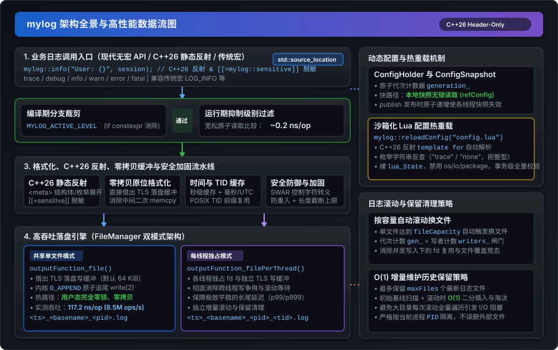

# mylog

<p align="center">
  
  
  
  
  
  
  
  
</p>

<p align="center">
  <b><a href="README.md">English</a></b> | <b><a href="README_zh.md">中文</a></b>
</p>

`mylog` 是一个专为高并发 Linux 环境设计的高性能、轻量级、Header-only C++26 日志库。

核心层实现**零第三方依赖**（仅需 C++26 标准库与 POSIX 系统调用），深度融合现代 C++26 `std::format` 类型安全格式化、C++26 静态反射（`<meta>`）、`std::source_location` 零宏调用、字段级数据脱敏与用户态零拷贝落盘设计，兼具极致性能与工业级工程安全性。

---

## 架构全景与数据流

<p align="center">
  
</p>

### 核心架构流水线说明：

1. **业务日志调用入口**：
   - **现代 C++26 无宏 API**：全面支持 `mylog::info(...)`、`mylog::debug(...)`、`mylog::warn(...)`、`mylog::error(...)`、`mylog::fatal(...)`、`mylog::trace(...)`，通过 `std::source_location` 自动捕获文件名、函数名与行号，不污染全局宏命名空间。
   - **C++26 静态反射格式化**：原生支持聚合结构体与作用域枚举自动反射输出；配合 `[[=mylog::sensitive]]` 属性标签实现字段级自动掩码脱敏（`"******"`）。
   - **传统宏兼容**：`LOG_INFO`、`LOG_DEBUG` 等经典宏全量保留，支持平滑迁移。

2. **亚纳秒级级别过滤闸门**：
   - **编译期裁剪**：定义 `MYLOG_ACTIVE_LEVEL` 时，低于该门限的日志通过 `if constexpr` 在编译期直接消除，零指令开销。
   - **运行期快速抑制**：基于宽松原子操作（Relaxed Atomic Load）过滤未激活级别的日志，耗时仅 **~0.2 ns/op**（吞吐 > 45 亿次/秒）。

3. **格式化、原位零拷贝缓冲与安全加固流水线**：
   - **零拷贝原位格式化（Zero-Copy Direct In-Place Formatting）**：接入 `FileManager` 时，`std::format` 直接借出线程局部落盘缓冲原位构建日志文本，彻底消除中间临时字符串分配与二次 `memcpy`。
   - **纳秒级高精度时钟与 TID 缓存**：采用 thread_local 秒级文本缓存与原位无栈纳秒格式化（`YYYY-MM-DD HH:MM:SS.nnnnnnnnn`，吞吐 7.38M ops/s），消除频繁调用 `localtime_r` 的内核与锁开销，搭配 POSIX `gettid()` 预格式化前缀复用。
   - **安全防御、健壮性与纯零异常架构**：64 位 SWAR 无分支控制字符快速扫描与转义（阻断 ANSI 注入与终端伪造）、线程局部防重入检测（拦截递归死锁）、单条日志长度上限强制截断，基于 RAII 事务卫述（`OutputBufferGuard`）实现全库纯零异常机制。

4. **FileManager 双模式高性能落盘引擎**：
   - **共享单文件模式（`createFileOutputFunction`）**：
     各业务线程独立持有线程局部写缓冲（`threadBufferCapacity`，默认 64 KiB），攒满后通过 Linux 内核 `write(2)` 追加至带有 `O_APPEND` 标志的文件描述符。追加原子性由内核维护，**在用户态彻底消除互斥锁争用与内存拷贝**，实测吞吐高达 **8.5M ops/s (117.2 ns/op)**。
   - **每线程独立文件模式（`createPerThreadFileOutputFunction`）**：
     每个工作线程拥有专属的独立日志文件与私有写缓冲，完全杜绝跨线程竞争与换文件排空等待，提供极致平稳的长尾延迟表现（p99/p999）。

5. **控制、动态配置与文件保留策略**：
   - **无锁快照动态配置（`ConfigHolder` / `ConfigSnapshot`）**：
     基于原子版本代次（Generation Counter）实现发布-订阅模式，各工作线程在热路径下直接读取本地线程快照（`refConfig()`），运行期更新配置原子递增版本号使快照无锁失效。
   - **沙箱化 Lua 配置热重载**：
     在裸 `lua_State` 中执行（禁用 `os`、`io`、`package` 等系统库），通过 C++26 静态反射（`template for`）全自动解析配置字段，支持枚举字符串映射（小写 `"trace"`、`"none"` 等），事务级全量校验（All-or-Nothing）。
   - **日志容量滚动与增量清理（Retention Policy）**：
     单文件达到 `fileCapacity` 时自动滚动，借助代次与并发写者计数闸门（`gen_` + `writers_`）确保并发无锁写入下文件安全切换；保留策略采用 $O(1)$ 增量队列，杜绝大目录下全量扫描磁盘阻塞，严格按目标特征后缀与时间戳格式校验隔离。

---

## 核心特性

- **Header-Only 与核心层零第三方依赖**：
  - 无需编译库文件，直接包含 `src/` 即可使用。
  - 核心模块（`logger.hpp`、`fileManager.hpp`、`configHolder.hpp`、`reflection.hpp`）不依赖任何第三方库。
  - 可选的 Lua 配置热加载模块（`configer_lua.hpp`）仅需引入 LuaJIT。

- **现代化 C++26 无宏调用（Macro-Free API）与静态反射**：
  - **基于 `std::source_location` 的现代化 API**：全面支持 `mylog::info(...)`、`mylog::debug(...)`、`mylog::warn(...)` 等无宏函数调用，在编译期自动捕获调用处的文件名、函数名与行号，不污染全局宏命名空间（传统 `LOG_INFO` 等宏亦完全保留并兼容）。
  - **C++26 静态反射（`<meta>`）**：原生支持任意用户自定义聚合结构体（Aggregate Struct）与作用域枚举（Scoped Enum）的直接格式化输出，无需手写任何特化或宏定义。
  - **字段级敏感数据脱敏**：支持通过 C++26 注解 `[[= mylog::sensitive]]` 标记敏感字段（如密码、Token），格式化日志时自动脱敏为 `"******"`，防止敏感信息泄漏。
  - **零拷贝原地缓冲格式化（Zero-Copy Direct In-Place Formatting）**：在搭配 `FileManager` 时，格式化引擎直接在线程局部落盘缓冲中进行原位构建，彻底消除热路径上的中间缓冲二次 `memcpy` 与堆内存动态分配。

- **亚纳秒级日志抑制过滤（Sub-Nanosecond Suppress Check）**：
  - **编译期裁剪**：通过宏 `MYLOG_ACTIVE_LEVEL` 控制最低生效级别，低于该级别的日志在编译期通过 `if constexpr` 完全消除。
  - **运行期快速判断**：基于宽松原子读取（Relaxed Atomic Load）过滤未激活级别的日志，耗时仅 **~0.2 ns/op**（吞吐 > 45 亿次/秒），抑制日志开销几乎为零。

- **无锁快路径动态配置（ConfigHolder / ConfigSnapshot）**：
  - 采用代次计数器（Generation Counter）快照设计。
  - 各工作线程在热路径下直接读取本地线程缓存快照，无需竞争互斥锁（Mutex）。
  - 运行期修改配置（`setConfig` / `reloadConfig`）原子递增代次，跨线程平滑失效并更新本地缓存。

- **超高吞吐落盘引擎（FileManager）**：
  - **共享单文件模式（`createFileOutputFunction`）**：
    - 各业务线程独立持有线程局部写缓冲（`threadBufferCapacity`，默认 64 KiB），写入仅为内存追加，热路径零系统调用、零锁。
    - 缓冲写满或超时后，整块通过 `write(2)` 追加至同一个带有 `O_APPEND` 标志的文件描述符（fd）。
    - 追加原子性完全由内核文件表项（file description）保证，**在用户态彻底消除锁竞争与二次拷贝**。
    - 滚动换文件时通过无锁代次与写者引用计数（`gen_` + `writers_`）安全切换，杜绝 fd 复用数据错乱。
  - **每线程独立文件模式（`createPerThreadFileOutputFunction`）**：
    - 每个线程维护自身专属的日志文件（`<YYYYMMDD_HHMMSS_nnnnnnnnn>_<tid>.log`），线程间零交互、零共享。
    - 彻底杜绝跨线程竞争，保障极端高负载场景下最优且最平稳的长尾延迟（p99/p999）。

- **智能日志滚动与增量清理（Retention Policy）**：
  - 单文件达到容量上限（`fileCapacity`，默认 100 MiB）时自动触发滚动，创建新日志文件。
  - FIFO 保留机制：仅保留最新的 `maxFiles` 个历史日志文件。
  - 增量维护优化：滚动时不遍历全目录，仅首次初始化或变更时扫描基线，后续滚动实现 $O(1)$ 插入与裁剪，防止在大目录（如共享目录）中引起磁盘 I/O 阻塞。
  - 文件名严格匹配特征后缀（`_<tid>.log`），绝不误删其他进程或同目录下的无关文件。

- **全方位安全性加固**：
  - **100% 零异常架构（完美兼容 `-fno-exceptions`）**：彻底消除全库 `try...catch` 语句与运行时异常开销。写缓冲回滚机制完全依托 RAII 事务守卫（`OutputBufferGuard`）实现，时间格式化基于 POSIX `localtime_r` 摆脱对系统 tzdb 抛异常的依赖。可直接在金融高频交易、游戏引擎与嵌入式等强制 `-fno-exceptions` 的极端严苛环境中开箱即用。
  - **日志注入与 ANSI 转义防护**：`escapeControlChars`（默认开启）自动转义控制字符（`\n`, `\r`, `\033`/ESC, `\x7f` 等），阻断日志伪造与终端劫持。
  - **重入防护（Reentrancy Guard）**：内置线程局部防重入标志，避免回调中重复打日志导致死锁或栈溢出。
  - **单条日志长度截断**：通过 `maxLogLength`（默认 1 MiB，范围 `[64 B, 64 MiB]`）防止超长畸形日志耗尽内存。
  - **可配置 FATAL 动作**：支持 `NONE`（默认，啥也不做，不终止进程，适合常驻服务与测试）、`EXIT`（调用 `std::exit()`）或 `ABORT`（调用 `std::abort()`）。
  - **沙箱化 Lua 配置安全解析**：使用裸 `lua_State`，完全不加载标准库（`io`, `os`, `package`, `debug` 均被禁用），杜绝配置脚本执行恶意系统命令；采用全量校验后统一发布的事务机制（All-or-Nothing），非法配置自动回滚。

---

## 性能基准测试（Benchmark）

在 Linux x86_64 环境下实测（4 线程并发，Release `-O2` 构建，每线程 1,000,000 条日志）：

| 测试场景 | 单条延迟 (Latency) | 吞吐量 (Throughput) | 场景说明 |
| :--- | :---: | :---: | :--- |
| **抑制日志（INFO 被过滤）** | **0.2 ns/op** | **~4,500 M ops/s** | 运行期级别原子检查快速丢弃 |
| **写文件（TLS 64 KiB 缓冲）** | **117.2 ns/op** | **~8.5 M ops/s** | 用户态无锁 + 内核 `O_APPEND` 直写 |
| **写文件（关闭 TLS 缓冲）** | 273.0 ns/op | ~3.7 M ops/s | 回退至全局互斥锁保护共享缓冲 |
| **终端 stdout -> `/dev/null`** | 215.2 ns/op | ~4.7 M ops/s | 重定向至 dev null 的控制台输出 |

> 本地复现基准测试命令：
> ```bash
> cmake -B build -DCMAKE_BUILD_TYPE=Release
> cmake --build build --target bench
> ./build/bin/bench 1000000 4
> ```

---

## 日志输出格式

日志默认按以下格式紧凑输出：

```text
2026-10-17 23:15:30.123456789 INFO [140283]main>>Application initialized successfully (main.cpp:42)
```

- **时间戳**：`YYYY-MM-DD HH:MM:SS.nnnnnnnnn`（固定纳秒高精度，支持本地时间或 UTC）。
- **级别**：`TRACE`, `DEBUG`, `INFO`, `WARN`, `ERROR`, `FATAL`（终端可开启彩色高亮）。
- **线程 ID**：`[<tid>]`，取自 POSIX `gettid()`。
- **函数名**：调用方函数名（`__func__`）。
- **正文**：用户格式化消息（默认经过控制字符转义）。
- **代码位置**：`(<file>:<line>)`。

---

## 快速上手

### 1. 现代化无宏日志 API（极速上手）

包含 `logger.hpp`，支持现代 C++26 无宏调用（通过 `std::source_location` 自动捕获源码位置）或传统宏：

```cpp
#include "logger.hpp"

int main()
{
    // C++26 现代化无宏调用（推荐，零全局宏污染）
    mylog::info("服务启动成功，监听端口: {}:{}", "127.0.0.1", 8080);
    mylog::warn("内存占用超过阈值: {}%", 85.5);
    mylog::error("数据库连接失败: {}", "connection timeout");

    // 传统宏（完全兼容保留）
    LOG_TRACE("Trace 调试信息: {}", 1);
    LOG_DEBUG("传感器数值: id={}, val={}", 42, 3.14);
    LOG_FATAL("不可恢复的严重故障"); // 默认动作：FATAL_ACTION::NONE（啥也不做，不终止进程；可配置为 EXIT 或 ABORT）
}
```

### 2. 高吞吐文件日志（多线程共享单文件）

将输出后端切换为 `FileManager` 的共享单文件模式：

```cpp
#include "logger.hpp"
#include "fileManager.hpp"
#include <thread>

int main()
{
    // 将后端重定向至文件输出（零拷贝直接借出落盘缓冲）
    mylog::Logger::getInstance().setOutputFunction(mylog::FileManager::createFileOutputFunction());
    mylog::Logger::getInstance().setFlushFunction(mylog::FileManager::createFileFlushFunction());

    // 多线程并发记录日志，业务线程热路径零互斥锁竞争
    auto worker = [](int id) {
        for (int i = 0; i < 1000; ++i) {
            mylog::info("Worker {} processing job {}", id, i);
        }
    };

    std::thread t1(worker, 1);
    std::thread t2(worker, 2);
    t1.join();
    t2.join();

    // 手动排空剩余日志缓冲
    mylog::Logger::getInstance().getConfig().flushFunction();
    return 0;
}
```

生成的日志文件命名格式为：`<YYYYMMDD_HHMMSS_nnnnnnnnn>_<tid>.log`。

### 3. 每线程独立文件模式

对尾延迟极度敏感的高并发服务，可开启每线程独立文件模式：

```cpp
#include "logger.hpp"
#include "fileManager.hpp"

int main()
{
    // 切换至每线程独占文件后端
    mylog::Logger::getInstance().setOutputFunction(mylog::FileManager::createPerThreadFileOutputFunction());
    mylog::Logger::getInstance().setFlushFunction(mylog::FileManager::createPerThreadFileFlushFunction());

    mylog::info("主线程日志");
    // 生成文件格式形如：<YYYYMMDD_HHMMSS_nnnnnnnnn>_<tid>.log
}
```

### 4. 运行期 C++ API 动态配置

```cpp
// 调整全局日志抑制级别（支持字符串反射或枚举常量，低于 WARN 的日志被亚纳秒丢弃）
mylog::setSuppressLevel("WARN"); // 亦可传入枚举：mylog::setSuppressLevel(mylog::LEVEL::WARN);

// 调整 Logger 配置
mylog::Logger::Config logCfg = mylog::Logger::getInstance().getConfig();
logCfg.escapeControlChars = true;         // 开启控制字符转义（防护 ANSI 注入）
logCfg.timestampUtc = false;              // false 为本地时间，true 为 UTC（纳秒精度固定常开）
logCfg.maxLogLength = 512ULL << 10;       // 单条日志截断上限 512 KiB
logCfg.fatalAction = mylog::FATAL_ACTION::EXIT; // FATAL 时调用 exit 退出而非默认 none
mylog::Logger::getInstance().setConfig(logCfg);

// 调整 FileManager 配置
mylog::FileManager::Config fileCfg = mylog::FileManager::getInstance().getConfig();
fileCfg.threadBufferCapacity = 64ULL << 10; // 线程局部缓冲 64 KiB
fileCfg.fileCapacity = 50ULL << 20;        // 单文件 50 MiB 后自动滚动
fileCfg.maxFiles = 10;                     // 最多保留 10 个历史日志
fileCfg.intervalFlushFile_ms = 5 * 1000;   // 每 5 秒（5000 毫秒）定时落盘
mylog::FileManager::getInstance().setConfig(fileCfg);
```

### 5. C++26 静态反射格式化与敏感数据脱敏

借助 C++26 核心静态反射特性（`<meta>`），用户自定义的聚合结构体与作用域枚举无需手工编写任何 `std::formatter` 特化或 `operator<<` 流重载，即可直接输出；配合 `[[= mylog::sensitive]]` 注解更可实现敏感数据零泄漏：

```cpp
#include "logger.hpp"

enum class TaskStatus { Queued, Running, Completed };

struct UserSession {
    uint64_t userId;
    std::string username;
    [[= mylog::sensitive]] std::string password; // 自动脱敏为 "******"
    [[= mylog::sensitive]] std::string apiKey;   // 自动脱敏为 "******"
    double balance;
    TaskStatus status;
};

int main()
{
    // 作用域枚举自动反射输出名称 "Running"
    mylog::info("Status: {}", TaskStatus::Running);

    // 聚合结构体自动反射输出各字段名与对应值，敏感字段自动脱敏为 "******"
    UserSession session{10086, "alice", "Secret123!", "sk-998877", 256.78, TaskStatus::Running};
    mylog::info("Active session: {}", session);
    // 输出: Active session: {userId: 10086, username: alice, password: "******", apiKey: "******", balance: 256.78, status: Running}
}
```

### 6. 沙箱化 Lua 配置热重载

使用 `configer_lua.hpp` 可以在服务运行期间通过修改 Lua 脚本动态热加载配置：

```cpp
#include "configer_lua.hpp"

// 加载并原子应用配置
if (!mylog::reloadConfig("config.lua")) {
    std::cerr << "配置解析失败，保持原有配置运行\n";
}
```

配置示例 `config.lua`：

```lua
logger = {
    suppressLevel = "trace",    -- 抑制级别（基于 C++26 静态反射解析枚举字符串，推荐小写）："trace" | "debug" | "info" | "warn" | "error" | "fatal"
    stdoutVivid = false,        -- 级别标签是否带 ANSI 颜色（终端建议 true，写文件建议 false）
    escapeControlChars = true,  -- 转义控制字符（阻断日志伪造）
    timestampUtc = false,       -- false 为本地时间，true 为 UTC（纳秒精度固定常开）
    maxLogLength = 1 << 20,     -- 单条日志最大字节数（1 MiB）
    fatalAction = "none"        -- 触发 FATAL 后的动作："none"（默认，啥也不做） | "exit" | "abort"
}

fileManager = {
    threadBufferCapacity = 64 << 10,   -- 线程局部缓冲字节数（64 KiB，0 为关闭）
    fileBufferCapacity = 128 << 10,    -- 共享写缓冲字节数（128 KiB）
    fileCapacity = 100 << 20,          -- 单文件滚动容量（100 MiB）
    intervalFlushFile_ms = 30 * 1000,  -- 定时落盘间隔（30 秒 = 30000 毫秒）
    maxFiles = 5                       -- 最多保留的历史文件数（0 为不自动清理）
}
```

> **安全说明**：`reloadConfig()` 在裸 `lua_State` 中执行，标准库全部未加载，配置脚本无法进行系统 I/O 或执行外部命令。若字段缺失或数值不合法，配置将整体回滚，杜绝脏配置。

---

## 配置参数速查表

### Logger 配置项 (`Logger::Config`)

| 配置字段 | 类型 | 默认值 | 作用说明 |
| :--- | :--- | :--- | :--- |
| `lv2str` | `const std::array<const char*, 6>*` | `&LV2STR` | 级别字符映射表（`&LV2STR` 无色，`&LV2STR_VIVID` 带 ANSI 色彩） |
| `suppressLevel` | `LEVEL` | `LEVEL::TRACE` | 日志最低生效级别，低于此级别立即丢弃 |
| `escapeControlChars` | `bool` | `true` | 是否对控制字符（`\n`, `\r`, `\033` 等）转义 |
| `timestampUtc` | `bool` | `false` | 是否使用 UTC 时间（默认本地时间，纳秒精度常开） |
| `maxLogLength` | `size_t` | `1ULL << 20` (1 MiB) | 单条日志最大字节长度，取值区间 `[64 B, 64 MiB]` |
| `fatalAction` | `FATAL_ACTION` | `NONE` | 触发 FATAL 后的系统动作：`NONE`（默认，啥也不做）, `EXIT` 或 `ABORT` |
| `outputFunction` | `OutputFunction` | `stdoutOutput` | 日志输出回调函数 `void (*)(void* ctx, std::string_view msg)` |
| `flushFunction` | `FlushFunction` | `stdoutFlush` | 刷盘回调函数 `void (*)(void* ctx)` |

### FileManager 配置项 (`FileManager::Config`)

| 配置字段 | 类型 | 默认值 | 作用说明 |
| :--- | :--- | :--- | :--- |
| `threadBufferCapacity`| `size_t` | `64UL << 10` (64 KiB) | 线程局部写缓冲区大小（设为 0 退化为单锁共享缓冲） |
| `fileBufferCapacity` | `size_t` | `128UL << 10` (128 KiB)| 共享缓冲区大小，取值区间 `[1 KiB, 256 MiB]` |
| `fileCapacity` | `size_t` | `100UL << 20` (100 MiB)| 单个日志文件最大字节容量，超过即滚动，取值 `[1 KiB, 64 GiB]` |
| `intervalFlushFile_ms`| `size_t` | `30UL * 1000` (30 秒) | 距离上次写盘超过该毫秒数即触发主动 flush |
| `maxFiles` | `size_t` | `5` | 最多保留的历史日志文件个数，取值 `[0, 1024]`（0 为不清理） |

---

## 编译与 CMake 引入

### 环境依赖
- 支持 C++26 的编译器（GCC 16+ 配合 `-freflection`，Clang 23+）
- POSIX 兼容系统（Linux）
- CMake 3.20 及以上
- *可选*：`luajit`（仅在使用 `configer_lua.hpp` 或构建带 Lua 的样例时需要）

### CMake 引入方式

作为现代纯头文件库，`mylog` 严格基于现代 CMake 目标导向理念设计，提供规范的带命名空间接口目标（`mylog::mylog` / `mylog::mylog_lua`）：

#### 1. 通过 `add_subdirectory` 接入：
```cmake
# 引入 mylog 根目录
add_subdirectory(path/to/mylog)

# 核心接口（零第三方依赖，自动传播 C++26 与头文件路径）：
target_link_libraries(your_project PRIVATE mylog::mylog)

# 可选的 Lua 配置热加载模块（自动链接 LuaJIT）：
target_link_libraries(your_project PRIVATE mylog::mylog_lua)
```

#### 2. 通过 `FetchContent` 接入：
```cmake
include(FetchContent)
FetchContent_Declare(
    mylog
    GIT_REPOSITORY https://github.com/your-username/mylog.git
    GIT_TAG main
)
FetchContent_MakeAvailable(mylog)

target_link_libraries(your_project PRIVATE mylog::mylog)
```

> **子项目引入隔离保障**：当通过 `add_subdirectory` 或 `FetchContent` 作为子项目引入时，`mylog` 的示例、测试与基准构建目标会自动默认为 `OFF`，且不会修改父工程的输出目录与构建类型。

### 构建测试与样例

```bash
# 克隆代码库
git clone https://github.com/your-username/mylog.git
cd mylog

# 默认独立构建（自动开启测试、示例与基准测试）
cmake -B build
cmake --build build -j

# 运行自动化测试套件（180 项测试检查，0 失败）
ctest --test-dir build --output-on-failure

# 编译并运行 Release 性能基准测试
cmake -B build_release -DCMAKE_BUILD_TYPE=Release
cmake --build build_release --target bench
./build_release/bin/bench
```

### CMake 构建开关

| 开关名称 | 独立构建默认值 | 作为子项目默认值 | 作用说明 |
| :--- | :---: | :---: | :--- |
| `MYLOG_BUILD_EXAMPLES` | `ON` | `OFF` | 构建 `examples/` 下的示例程序 |
| `MYLOG_BUILD_TESTS` | `ON` | `OFF` | 构建 `tests/` 下的自动化测试套件 |
| `MYLOG_BUILD_BENCH` | `ON` | `OFF` | 构建 `bench/` 下的性能微基准测试程序 |
| `MYLOG_SANITIZE` | `ON` (Debug) | `OFF` | 启用 ASan 与 UBSan 内存及未定义行为检测 |
| `MYLOG_ENABLE_LUA` | `ON` | `ON` | 启用沙箱化 Lua 配置热重载支持（需 LuaJIT） |
| `MYLOG_BUILD_TSAN_TEST` | `OFF` | `OFF` | 构建独立的 ThreadSanitizer 线程竞态检测目标 |

---

## 代码规范与自动化门禁

本项目遵循工业级开源规范，通过多层自动化工具强制落地代码排版与命名风格：

| 约束层次 | 工具与配置 | 触发时机 | 作用与功能 |
| :--- | :--- | :--- | :--- |
| **编辑器层** | [`.editorconfig`](.editorconfig) | 键盘键入 / 保存 | 统一 UTF-8 编码、LF 换行、4 空格缩进、去除行尾空格 |
| **IDE 排版** | [`.vscode/settings.json`](.vscode/settings.json) | Ctrl+S 保存 | 触发 Clang-Format 自动格式化（Allman 大括号换行、120 字符列宽） |
| **命名约束** | [`.clang-tidy`](.clang-tidy) | 静态代码分析 | 校验命名风格：类名 `CamelCase`、成员变量 `camelBack_`、枚举/宏 `UPPER_CASE`、常量 `kCamelCase` |
| **构建目标** | `CMakeLists.txt` (`format` / `format-check`) | 本地构建 / CI 门禁 | `cmake --build build --target format`（一键就地修复）；`format-check`（违规退出码非零，阻断构建） |
| **Git 门禁** | [`.githooks/pre-commit`](.githooks/pre-commit) | `git commit` 时 | 提交前自动校验暂存区代码风格，格式不符直接拒绝提交 |

> **一键开启 Git 提交门禁**：
> ```bash
> git config core.hooksPath .githooks
> # 或执行安装脚本：
> bash scripts/setup-hooks.sh
> ```

---

## 目录结构

```text
.
├── CMakeLists.txt              # 根 CMake 构建文件（包含 format / format-check 目标）
├── LICENSE                     # MIT 开源许可证
├── .editorconfig               # 基础编码与缩进规范
├── .clang-format               # C++ 代码排版与格式化规范（Allman 风格）
├── .clang-tidy                 # C++ 命名约定与静态检查规则
├── .githooks/                  # Git Commit 提交前自动化代码排版门禁
├── .github/                    # GitHub Actions 自动化 CI 门禁流水线
├── scripts/                    # 开发者辅助脚本（如 setup-hooks.sh）
├── assets/                     # 架构与数据流高清矢量图（SVG）
│   ├── architecture.svg        # 英文架构全景与高性能数据流图
│   └── architecture_zh.svg     # 中文架构全景与高性能数据流图
├── src/                        # 核心头文件目录（Header-only）
│   ├── CMakeLists.txt          # 定义 mylog 与 mylog_lua 目标
│   ├── logger.hpp              # 日志核心引擎、std::format 封装、级别与无宏 API
│   ├── reflection.hpp          # C++26 静态反射（枚举/结构体打印、脱敏）
│   ├── configHolder.hpp        # 基于代次计数的无锁配置快照管理器
│   ├── fileManager.hpp         # 落盘引擎、线程局部缓冲、文件滚动与保留清理
│   └── configer_lua.hpp        # 可选的沙箱化 Lua 配置热重载组件
├── examples/                   # 示例代码
│   ├── 1_a_simple_start.cpp    # 快速上手（控制台输出）
│   ├── 2_set_suppress_level.cpp# 级别过滤与 Lua 配置加载示例
│   ├── 3_output_to_file.cpp    # 多线程共享单文件落盘演示
│   ├── 4_output_to_file_per_thread.cpp # 每线程独立文件落盘演示
│   ├── 5_reflection.cpp        # C++26 静态反射打印与敏感字段脱敏演示
│   ├── example_config.hpp      # 示例辅助配置探测头文件
│   └── config.lua              # 带详细中英文注释的 Lua 配置示例文件
├── bench/                      # 性能基准测试
│   ├── CMakeLists.txt
│   └── bench.cpp               # 多线程吞吐与延迟基准测试程序
├── tests/                      # 单元与集成测试套件（180 项全面检查）
│   ├── CMakeLists.txt
│   ├── main.cpp                # 测试运行入口与汇总报告器
│   ├── test_common.hpp         # 测试断言宏与测试用例注册表
│   ├── test_common.cpp         # 独立轻量级断言框架实现
│   ├── test_logger.cpp         # 日志核心、格式化、安全与零异常测试
│   ├── test_file_manager.cpp   # FileManager、TLS 缓冲、文件滚动与保留清理测试
│   ├── test_config_lua.cpp     # 沙箱化 Lua 配置热重载测试
│   └── test_reflection.cpp     # C++26 静态反射与敏感字段脱敏测试
```

---

## 开源协议

本项目采用 MIT 协议开源，详情请参阅 [LICENSE](LICENSE) 文件。
